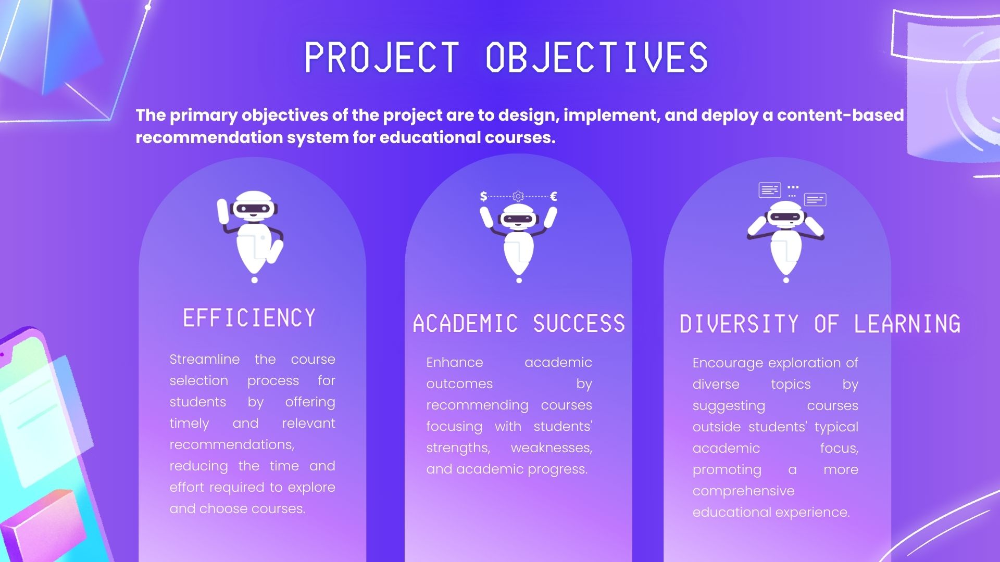
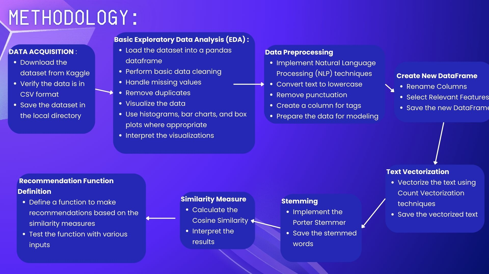

# Educational Course Recommendation System

## Overview
This project is aimed at recommending educational courses to users. It utilizes a 'Content Based' Recommendation System that suggests courses based on user input of a selected course. Techniques such as Pre-processing, Count Vectorization, Stemming, and Cosine Similarity are employed for generating recommendations.

## Deployment
The project is deployed on Vercel and can be accessed through the following link: [Educational Course Recommendation System](https://educational-course-recommendation-system.vercel.app/)

The FastAPI backend runs on Render's free tier, which puts the server to sleep when nobody has used it for a while. If the course list takes a moment to show up, that is the server waking up (it can take up to a minute). The page now shows a loading message and retries on its own, and a small GitHub Actions workflow pings the backend every 10 minutes so it usually stays awake.

## Project Structure
The repository contains the following files and directories:
- `frontend`: Contains files related to the frontend of the application.
- `backend`: Contains files related to the backend of the application.
- `Coursera.csv`: CSV file containing details of approximately 3000 courses.
- `code.ipynb`: Jupyter Notebook containing code for the recommendation system.
- `ppt`: Slides from the project presentation.
- `.github/workflows/keep-backend-awake.yml`: Scheduled ping that keeps the backend from going to sleep.
- `.DS_Store`: System file that can be ignored.
- `backend/requirements.txt`: File specifying the Python dependencies required for the backend.

## Tech Stack
The project utilizes the following technologies:
- scikit-learn: For implementing machine learning algorithms.
- FastAPI: For building the backend API.
- Next.js: For building the frontend of the application.

